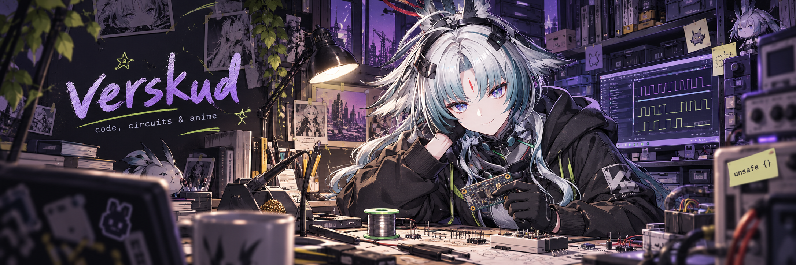

<p align="center">
  
</p>

<h3 align="center">low-level code / high-level brainrot</h3>

<p align="center">
  
</p>

### `whoami`

**C++ enjoyer :3** — into **embedded systems**, **microelectronics**, and what happens underneath the abstractions.

If it has registers, pins, or a datasheet, you have my attention.

```toml
[interests]
software = ["embedded", "firmware", "low-level programming"]
hardware = ["microelectronics", "microcontrollers", "circuits"]
off_duty = "Arcane / Arknights: Endfield"
```

### `ls projects/`

**↳ [AstraLauncher](https://github.com/Verskud/AstraLauncher)**  
An independent Minecraft: Java Edition launcher for Windows. Open source, MIT licensed.  
[source](https://github.com/Verskud/AstraLauncher) · [latest release](https://github.com/Verskud/AstraLauncher/releases/latest)

---

<p align="center">
  <sub>code close to the metal. Arcane close to the heart.</sub><br />
  <sub>Arcane · Arknights: Endfield © HYPERGRYPH / GRYPHLINE · unofficial fan art</sub>
</p>
