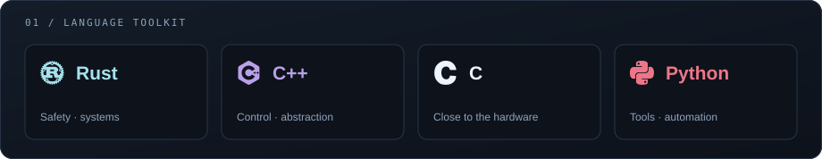
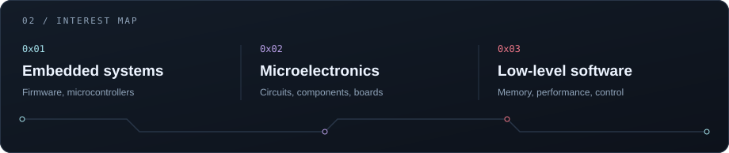
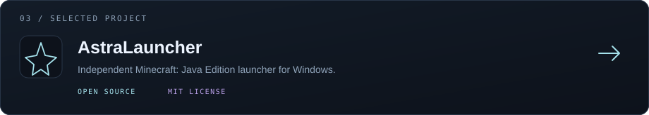

  

  <b>Somewhere between code and silicon.</b> 
  Rust · C++ · C · Python

I’m **Verskud**. My interests live where software meets hardware: **embedded systems, microelectronics, and low-level programming**. I enjoy understanding what happens beneath the abstractions and turning that understanding into things I can build.

  

  

  <a href="https://github.com/Verskud?tab=repositories">Repositories</a> &nbsp;·&nbsp;
  <a href="https://github.com/Verskud/AstraLauncher/releases/latest">AstraLauncher releases</a>

  Visual theme inspired by Arcane · Arknights: Endfield © HYPERGRYPH / GRYPHLINE. Unofficial fan artwork.

