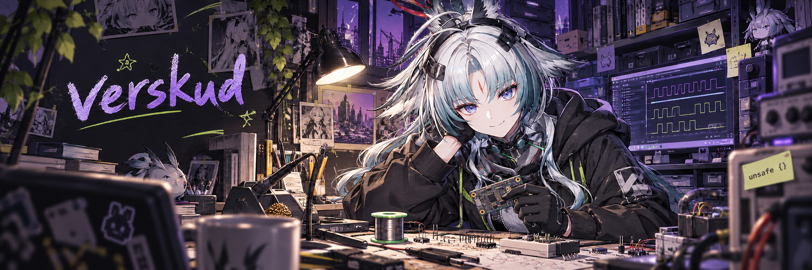

  

# Verskud :de: :us:

### About

I'm learning C, C++ and Rust. My main interests are embedded systems and microelectronics.

### Languages

  

### Learning

For now, I'm focusing on the fundamentals. I want to get more comfortable with microcontrollers, firmware and the electronics behind them.
